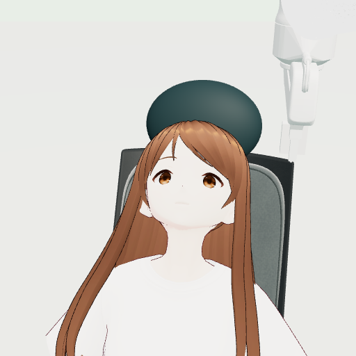

# Image-Based Eye-Drop Robot

[日本語](README.ja.md) | **English**

This project explores using camera images to control a robot arm that handles a conventional eye-drop bottle. It is intended as a study of how a robot might assist people who have difficulty applying eye drops themselves. The person, robot, bottle, and drop are all represented **in simulation**.

We developed a fixed-procedure demonstration and used it to fine-tune an existing robot AI model. No experiments were conducted on a physical robot or a human subject.



## How it works

The robot receives images from two cameras, the state of its arm and fingers, and a shared task instruction. It outputs arm movements and the finger width used to press the bottle. Ground-truth eye coordinates, the person's identity, and the bottle's internal drop state are not provided as AI inputs.

- **Simulation**: PyBullet and Three.js
- **Robot learning**: [LeRobot](https://github.com/huggingface/lerobot) and the pretrained [SmolVLA](https://huggingface.co/lerobot/smolvla_base) model
- **Initial training data**: 12 successful fixed-procedure demonstrations, split into 6 for training and 6 for testing; later development used additional recovery demonstrations
- **Task**: approach the eye, wait until it is open, press the bottle to release one drop, open the fingers, and retreat

The bottle is fixed to the arm; pressing and drop release are represented by simplified models.

## Results

In an initial comparison, we tested the fixed procedure and the AI model before and after one fine-tuning run, using two character models that had previously been used during development. Each method was tested once per character.

| Method | Character model A | Character model B |
| --- | --- | --- |
| Fixed-procedure demonstrator | Released one drop, released pressure, and retreated | Released one drop, released pressure, and retreated |
| AI: before latest fine-tuning | Did not release a drop | Did not release a drop |
| AI: after latest fine-tuning | Stopped at 0.25 seconds after an out-of-range finger-width command | Pressing was not sustained during the 60-second simulation; no drop was released |

The pre-fine-tuning comparison used weights that had already been updated 600 times from the public pretrained model. The post-fine-tuning weights received another 3,000 updates using the demonstrations in this experiment. These are single trials for each condition; they do not establish a general success rate or performance on previously unseen characters.

In a later hybrid configuration, the learned model handled the final approach and position holding, while fixed control handled pressing, release and retreat. Under natural blinking, one trial on each of two development characters applied one drop to the open target eye, released the bottle and returned without recorded contact. The exploratory 2.5 mm threshold controlled when pressing could begin; it was not the scoring criterion for whether the drop reached the eye, and the earlier 1 mm criterion was not demonstrated by this test.

When retreat was also delegated to an additional learned candidate, each character received one drop in one diagnostic trial, but finger release and return to the starting position remained incomplete. The candidate failed its prior retention criterion and was not adopted. Sudden eyelid closure and residual pressure remain unresolved. These development trials do not establish performance on unseen characters or safety outside the simulation.

## Repository contents

| Path | Contents |
| --- | --- |
| `scripts/` | Code used to collect demonstrations, prepare data, train, and evaluate |
| `outputs/runtime/review-sklearn-v1/src/` | Code for face recognition, physics simulation, and control |
| `preview/` | Code and assets for rendering characters, the arm, and the bottle |
| `source-deltas/` | Changes to image recording and aggregation made after the experiment |
| [CREDITS.md](CREDITS.md) | Asset sources and usage terms, in Japanese |
| [SOURCE_PROVENANCE.md](SOURCE_PROVENANCE.md) | Provenance and verification status of the archived and supplemented code, in Japanese |

For the initial comparison, character model A is pixiv's VRM1_Constraint_Twist_Sample, model B is Seed-san, and the third model used for training is Godette. The later development trials used two VRoid Project sample characters; see [CREDITS.md](CREDITS.md).

## Environment and checks

The experiments used an Apple Silicon Mac, Python 3.12, PyTorch 2.11, LeRobot 0.6.1, PyBullet 3.2.7, scikit-learn 1.8.0, and other dependencies.

**The demonstration data, position estimator, weights before and after fine-tuning, and random states are not included in this repository.** Reproduction of the reported results from this repository alone has therefore not been verified. The conditions and method for distributing the data and weights have not been established. The public `smolvla_base` model alone does not provide the previously updated weights used for the comparison.

In the existing Mac environment, we verified that the main Python modules for collection, training, and evaluation could be imported. Some unit tests for the rendering-side code can be run as follows:

```sh
cd preview
npm ci --ignore-scripts
node --test anatomy-contact.test.mjs anatomy-score.test.mjs learning-conditions.test.mjs
```

These checks cover 13 unit tests; they do not establish that the complete eye-drop task can be reproduced or run in another environment.

The following 10 synthetic-data unit tests cover sequence analysis and pressure-audit contracts. On macOS, with `pytest` and `numpy` installed, run them from the repository root:

```sh
PYTHONPATH="scripts:outputs/runtime/review-sklearn-v1/src" \
  python -m pytest -q -c /dev/null -p no:cacheprovider \
  tests/test_sequence_result_analysis.py \
  tests/test_relative_sequence_cycle.py \
  tests/test_pressure_audit_contract.py
```

The explicit source path matters: another saved `eyedrop.bottle` version lacks `step_measured` and caused one pressure-audit test to fail. The command above passed all 10 tests on macOS with Python 3.12.15, NumPy 2.2.6 and pytest 9.1.1, using the files supplied here. It does not run training or establish end-to-end reproducibility; the test covering `fcntl` requires a POSIX environment.

## Future work

The AI must learn to maintain a stable finger width and complete the sequence from waiting for an open eye through pressing, releasing, and retreating. Performance with other characters, actual bottles and liquids, and real-time operation has not been evaluated.

For asset sources and usage terms, see [CREDITS.md](CREDITS.md) (in Japanese).


## Additional experiment source

The related training and evaluation source is in [`source-deltas/retreat-comparison-20261101`](source-deltas/retreat-comparison-20261101/README.md). This is an inspection snapshot; datasets, checkpoints and a verified end-to-end reproduction are not included.
